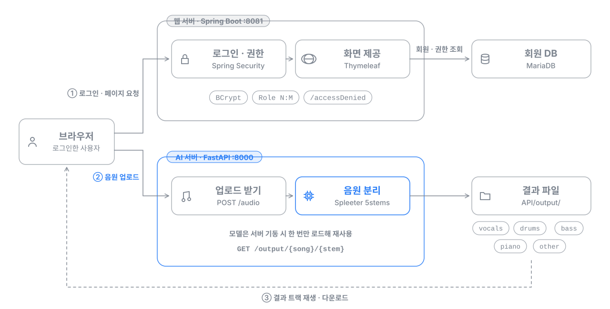

# MusicSplitterWeb — AI 음원 분리 웹 서비스


-FF6F00?logo=tensorflow&logoColor=white)

노래 한 곡을 올리면 보컬, 드럼, 베이스, 피아노, 나머지 반주 5개 트랙으로 나눠 주는 웹 서비스입니다. 2023년 6월 학부 프로젝트로 기획부터 구현까지 혼자 9일 만에 완성했습니다.

## 한눈에 보기

- **무엇을**: 로그인한 사용자가 음원을 올리면 AI 모델이 5개 트랙으로 분리하고, 브라우저에서 바로 듣고 내려받습니다.
- **내가 한 일**: 웹 서버(Java), AI 서버(Python), DB 설계, 화면까지 1인 개발
- **어떻게**: 로그인과 화면은 Spring Boot, 무거운 AI 처리는 FastAPI로 서버를 나눠 언어별로 역할을 분담했습니다.
- **결과**: 회원가입, 로그인, 업로드, 5개 트랙 재생과 다운로드까지 전체 흐름이 동작합니다. ([데모 영상](#데모-영상))


## 동작 구조



1. 사용자는 **웹 서버(Spring Boot)** 에서 회원가입과 로그인을 하고, 로그인해야 업로드 페이지가 열립니다.
2. 업로드 페이지가 음원 파일을 **AI 서버(FastAPI)** 로 보냅니다.
3. AI 서버가 Spleeter 모델로 곡을 5개 트랙으로 나누고 결과 파일 주소를 돌려줍니다.
4. 페이지가 트랙마다 플레이어를 만들어 바로 듣거나 내려받을 수 있게 합니다.

## 담당 범위

| 파트 | 한 일 |
|---|---|
| 구조 설계 | 웹 서버와 AI 서버를 나눈 2-서버 구조 설계 |
| AI 서버 | 업로드, 분리, 결과 제공 API 구현. 모델을 서버 기동 시 한 번만 로드해 재사용 |
| 로그인과 권한 | Spring Security 설정(공개 경로, 로그인, 로그아웃, 접근 거부), BCrypt 비밀번호 저장 |
| 데이터 모델 | 사용자와 역할의 N:M 테이블 설계, JPA 엔티티와 리포지토리 |
| 화면 | Bootstrap 화면, 업로드 AJAX, 로딩 모달, 트랙별 플레이어 |

## 데모 영상

https://user-images.githubusercontent.com/46620366/246123423-43fdbebd-e9bf-4fe4-9b8f-673d8dbb8dca.mp4

## 주요 기능

| 구분 | 기능 | 구현 |
|---|---|---|
| 인증 | 회원가입 | `POST /signUp`, BCrypt 해시 후 저장하고 기본 역할 부여 |
| 인증 | 로그인과 로그아웃 | 커스텀 로그인 페이지, 로그아웃 시 세션 무효화 |
| 인가 | 접근 제어 | 공개 경로와 로그인 필요 경로 분리, 거부 시 `/accessDenied` |
| 사용자 관리 | 사용자와 역할 N:M | JPA `@ManyToMany`, `CustomUserDetailsService`로 권한 로딩 |
| 음원 분리 | 5-stem 분리 | `POST /audio`, `spleeter:5stems` 모델 재사용 |
| 결과 제공 | 재생과 다운로드 | `GET /output/{name}/{stem}` |
| UX | 진행 표시 | 처리 중 로딩 모달, 실패 시 오류 메시지 표시 |

## 기술 스택

| 영역 | 기술 |
|---|---|
| 웹 서버 | Java 11, Spring Boot 2.7.8, Spring Security, Spring Data JPA, Gradle 7.6 |
| 화면 | Thymeleaf, Bootstrap 4, jQuery 3.5 |
| DB | MariaDB |
| AI 서버 | Python 3.8, FastAPI 0.97, Uvicorn 0.22 |
| AI 모델 | Spleeter 2.3.2 `spleeter:5stems` 사전학습 모델 |

## 디렉터리 구조

```
music-splitter-web/
├── API/                        # AI 서버 (FastAPI)
│   ├── main.py                 # /audio, /output 엔드포인트와 Spleeter 로드
│   └── requirements.txt
└── Spring/                     # 웹 서버 (Spring Boot)
    ├── schema.ddl, data.ddl    # 테이블 생성과 역할 데이터
    └── src/main/
        ├── java/acc/security/  # 보안 설정, 서비스, 사용자, 컨트롤러
        └── resources/          # application.yml, templates/
```

업로드 원본과 분리 결과는 실행할 때 `API/output/`에 생성되고, Spleeter 모델은 첫 실행 때 자동으로 내려받습니다.

## 실행 방법

준비물: JDK 11 이상, Python 3.8, FFmpeg, MariaDB

**1) DB**: 데이터베이스를 만들고 스키마를 적용한 뒤, 접속 정보를 환경변수로 지정합니다.

```bash
mysql -u <user> -p music_splitter < Spring/schema.ddl
mysql -u <user> -p music_splitter < Spring/data.ddl
export DB_URL=jdbc:mariadb://localhost:3306/music_splitter
export DB_USERNAME=<user>
export DB_PASSWORD=<password>
```

**2) AI 서버**

```bash
cd API
python -m venv venv && source venv/bin/activate   # Windows: venv\Scripts\activate
pip install -r requirements.txt
uvicorn main:app --host 127.0.0.1 --port 8000
```

**3) 웹 서버**

```bash
cd Spring
./gradlew bootRun
```

`http://localhost:8081`에서 회원가입 후 로그인하고, **기능** 메뉴(`/spleeter`)에서 음원을 업로드합니다.

## 개선 방향

- 업로드 요청을 Spring이 인증한 뒤 AI 서버로 전달하는 구조로 바꿔, AI 서버를 외부에 직접 노출하지 않기
- 긴 곡은 작업 큐와 상태 조회 방식으로 비동기 처리하기
- 결과 파일을 객체 스토리지에 두고 서명된 URL로 제공하는 서버리스 배포

## 다른 프로젝트

최근 프로젝트: [smartfarm-adaptive-rag](https://github.com/NAMUORI00/smartfarm-adaptive-rag), [multiview-selective-vqa](https://github.com/NAMUORI00/multiview-selective-vqa)
