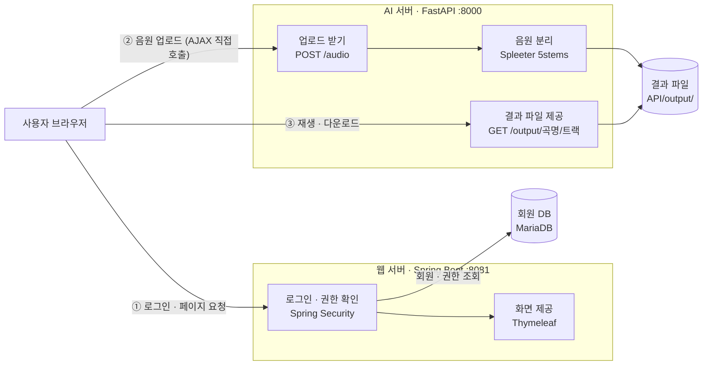
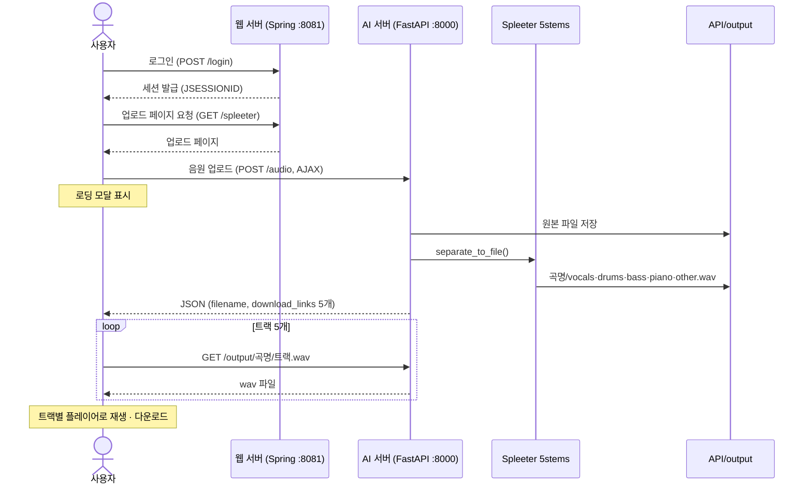

# MusicSplitterWeb — AI 음원 분리 웹 서비스


-FF6F00?logo=tensorflow&logoColor=white)

노래 한 곡을 올리면 보컬·드럼·베이스·피아노·나머지 반주 5개 트랙으로 나눠 주는 웹 서비스입니다.
2023년 6월 학부 수업 과제로 혼자 만든 프로젝트이며, 이력서에 학부 프로젝트로 소개한 저장소입니다.

> **EN** — Undergraduate solo project (2023): a web service that splits a song into 5 stems with Spleeter.
> Spring Boot + Spring Security handle login and pages; a FastAPI server runs the separation.

## 한눈에 보기

- **무엇을** — 로그인한 사용자가 음원을 올리면 AI 모델로 5개 트랙을 분리하고, 브라우저에서 바로 듣고 내려받는 서비스
- **내가 한 일** — 기획부터 웹 서버(Java), AI 서버(Python), DB 설계, 화면까지 1인 개발 (커밋 22건 전부 본인)
- **어떻게** — 로그인·화면은 Spring Boot, 무거운 AI 처리는 FastAPI로 서버를 나눠 언어별로 역할 분담
- **결과** — 회원가입 → 로그인 → 업로드 → 5개 트랙 재생·다운로드까지 로컬에서 동작 ([데모 영상](#데모-영상))


## 나의 기여

개인 프로젝트입니다. 커밋 작성자 `Kim Yu Seok` · `NAMUORI` · `namuori00`은 모두 본인(김유석, [@NAMUORI00](https://github.com/NAMUORI00))이
작업 환경(GitHub 웹·개인 PC·학교 PC)에 따라 다르게 남은 이름입니다.

| 항목 | 내용 |
|---|---|
| 기간 | 2023-06-08 ~ 2023-06-16 |
| 커밋 | 22건 (100% 본인) |
| 코드 변경량 | 약 +1,730 / −150 lines (외부 HTML 템플릿·샘플 wav·gradle wrapper jar 제외) |

| 파트 | 한 일 | 주요 파일 |
|---|---|---|
| 구조 설계 | 웹 서버와 AI 서버를 나눈 2-서버 구조 설계 | 저장소 전체 (`Spring/`, `API/`) |
| AI 서버 | 업로드·분리·결과 제공 API 구현, 모델을 서버 기동 시 1회만 로드해 재사용, CORS 설정 | `API/main.py`, `API/requirements.txt` |
| 로그인·권한 | Spring Security 설정(공개 경로, 로그인/로그아웃, 접근 거부 페이지), BCrypt 비밀번호 저장, 사용자 조회 서비스 | `Spring/src/main/java/acc/security/config/security/SecurityConfiguration.java`, `.../service/CustomUserDetailsService.java`, `.../user/service/UserService.java` |
| 데이터 모델 | 사용자·역할 N:M 테이블 설계, JPA 엔티티·리포지토리 | `Spring/schema.ddl`, `Spring/data.ddl`, `.../user/model/`, `.../user/dao/` |
| 화면 | 페이지 컨트롤러, Bootstrap 화면 구성, 업로드 AJAX·로딩 모달·트랙별 플레이어 스크립트 | `.../web/`, `Spring/src/main/resources/templates/spleeter.html` 외 |

## 어떻게 동작하나요

1. 사용자는 **웹 서버(Spring Boot)** 에서 회원가입·로그인을 하고, 로그인해야 업로드 페이지가 열립니다.
2. 업로드 페이지는 음원 파일을 **AI 서버(FastAPI)** 로 바로 보냅니다.
3. AI 서버가 Spleeter 모델로 곡을 5개 트랙으로 나누고, 결과 파일 주소를 돌려줍니다.
4. 페이지가 트랙마다 플레이어를 만들어 바로 듣거나 내려받을 수 있게 합니다.



> 업로드는 Spring을 거치지 않고 브라우저가 AI 서버를 직접 호출합니다. 이 구조의 문제와 개선 계획은 [한계 및 TODO](#한계-및-todo)에 정리했습니다.

### 업로드 → 분리 → 재생 흐름



## 데모 영상

https://user-images.githubusercontent.com/46620366/246123423-43fdbebd-e9bf-4fe4-9b8f-673d8dbb8dca.mp4

## 주요 기능

| 구분 | 기능 | 구현 |
|---|---|---|
| 인증 | 회원가입 | `POST /signUp` → BCrypt 해시 후 저장, 기본 역할 부여 (`UserService`) |
| 인증 | 로그인 / 로그아웃 | `formLogin` 커스텀 페이지, 로그아웃 시 세션 무효화·`JSESSIONID` 삭제 |
| 인가 | 접근 제어 | `/`, `/home`, `/signUp` 공개 · `/spleeter` 로그인 필요 · `/system` SYSTEM 역할 · 거부 시 `/accessDenied` |
| 사용자 관리 | 사용자-역할 N:M | JPA `@ManyToMany` + `tb_user_roles`, `CustomUserDetailsService`로 권한 로딩 |
| 화면 | 로그인 상태별 메뉴 | `thymeleaf-extras-springsecurity5`의 `sec:authorize` |
| 음원 분리 | 5-stem 분리 | `POST /audio` — `spleeter:5stems` 모델은 서버 기동 시 1회 로드 |
| 결과 제공 | 재생 / 다운로드 | `GET /output/{name}/{stem}` → `FileResponse` |
| UX | 진행 표시 | 처리 중 로딩 모달, 실패 시 상태 코드·오류 메시지 표시 |

## 기술 스택

| 영역 | 기술 |
|---|---|
| 웹 서버 | Java 11, Spring Boot 2.7.8, Spring Security, Spring Data JPA, Lombok, Gradle 7.6 |
| 화면 | Thymeleaf, Bootstrap 4, jQuery 3.5 (CDN) |
| DB | MariaDB |
| AI 서버 | Python 3.8, FastAPI 0.97, Uvicorn 0.22 |
| AI 모델 | Spleeter 2.3.2 `spleeter:5stems` 사전학습 모델 (TensorFlow 기반) |

## 디렉터리 구조

```
MusicSplitterWeb/
├── API/                        # AI 서버 (FastAPI)
│   ├── main.py                 # /audio, /output 엔드포인트 + Spleeter 로드
│   └── requirements.txt
└── Spring/                     # 웹 서버 (Spring Boot)
    ├── schema.ddl / data.ddl   # 테이블 생성 · 역할 데이터
    └── src/main/
        ├── java/acc/security/  # config(보안 설정) · service · user · web(컨트롤러)
        └── resources/          # application.yml(포트 8081, DB), templates/
```

**결과 파일 안내** — 예전에는 샘플 분리 결과(`API/output/*.wav`)가 저장소에 들어 있었지만 지금은 제거했고 Git 추적에서도 뺐습니다.
업로드 원본과 분리된 wav 파일은 **실행할 때마다 `API/output/`에 새로 생성**됩니다. Spleeter 사전학습 모델(`API/pretrained_models/`)도 첫 실행 때 자동으로 내려받습니다.

## 실행 방법

로컬 환경 기준입니다. 준비물: JDK 11+, Python 3.8, FFmpeg(Spleeter 오디오 처리에 필요), MariaDB

**1) DB** — `application.yml` 접속 정보(기본 `localhost:8889`, DB·계정 `myjeju`)에 맞춰 DB를 만들고 스키마를 적용합니다. (`ddl-auto: validate`라 테이블이 미리 있어야 함)

```bash
mysql -u <user> -p myjeju < Spring/schema.ddl
mysql -u <user> -p myjeju < Spring/data.ddl   # 예시 사용자는 비밀번호가 평문이라 로그인 불가 → 회원가입으로 새 계정 사용
```

**2) AI 서버**

```bash
cd API
python -m venv venv && source venv/bin/activate   # Windows: venv\Scripts\activate
pip install -r requirements.txt
uvicorn main:app --host 127.0.0.1 --port 8000     # http://localhost:8000/docs 에서 API 테스트
```

**3) 웹 서버**

```bash
cd Spring
./gradlew bootRun
```

`http://localhost:8081` → 회원가입 → 로그인 → **기능** 메뉴(`/spleeter`)에서 업로드.

## 한계 및 TODO

당시 과제 기간 안에 끝내는 것을 우선해 로컬 실행 형태로 마무리했습니다. 지금 다시 보면 고칠 점은 아래와 같습니다.

- [ ] **Spring 경유 API 호출로 변경** — 지금은 브라우저가 AI 서버를 직접 호출해서 로그인 없이도 API를 쓸 수 있음. Spring이 인증 후 대신 호출하도록 변경
- [x] **CORS에 8081 허용** — `API/main.py`의 허용 Origin에 웹 서버 포트(`8081`) 추가
- [x] **결과 폴더 자동 생성** — 서버 시작 시 `API/output/`을 만들도록 수정
- [ ] **`/signUp` 경로 대소문자 수정** — `home.html`·`spleeter.html`의 회원가입 링크가 `/signup`이라 컨트롤러(`/signUp`)와 맞지 않음
- [ ] **`ROLE_` 접두사 권한 수정** — DB 역할명(`SYSTEM` 등)을 그대로 권한으로 넣어 `hasRole('SYSTEM')`(=`ROLE_SYSTEM`)과 매칭되지 않음. 회원가입 기본 역할 ID(2 = BOARD)와 주석(USER)도 불일치
- [ ] **관리자 페이지 완성** — `/system` 라우트와 SYSTEM·BOARD·USER 역할 모델까지만 구현
- [ ] **API 주소 설정값으로 분리** — `spleeter.html`에 `localhost:8000`이 고정되어 있음
- [ ] **긴 곡 처리** — 분리가 요청 안에서 동기로 실행됨. 작업 큐 + 상태 조회 방식, 업로드 파일명 정규화(UUID), 결과 파일 정리 정책 필요
- [ ] **AWS Lambda / S3 배포** — 처음 목표였던 서버리스 배포. 결과는 S3에 저장하고 서명된 URL로 제공하는 구조 검토

**회고** — 언어가 다른 두 서버로 역할을 나누는 구조와 로그인·권한 처리를 처음 경험한 프로젝트입니다. Spring Security 권한 규칙을 제대로 이해하지 못해 관리자 기능을 완성하지 못한 점이 아쉬웠고, 이후 학습 과제로 삼았습니다.

## 다른 프로젝트

최근 프로젝트: [smartfarm-adaptive-rag](https://github.com/NAMUORI00/smartfarm-adaptive-rag) · [multiview-selective-vqa](https://github.com/NAMUORI00/multiview-selective-vqa)
